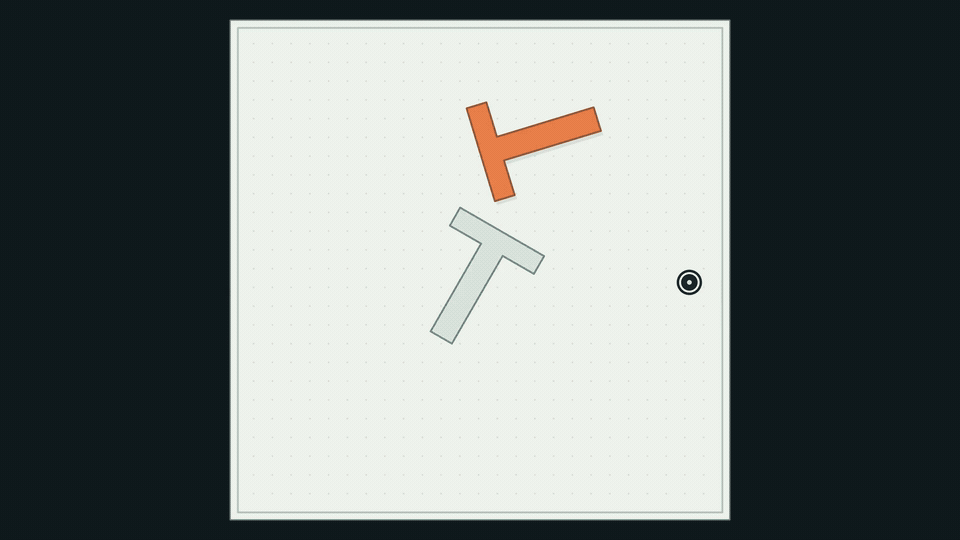

# Push Any Letter

A macOS-compatible 2D pushing simulator for letter-shaped rigid bodies, with a Gymnasium API, a contact-sampling planner, and state/image imitation-learning baselines.

The public dataset contains **6,240 replay-validated successful demonstrations**: 52 ASCII letters × 12 goal orientations × 10 trajectories. Every goal is at the arena center. Different starting poses and planner seeds produce different solutions to the same goal.

[Project page](https://DavidLXu.github.io/Push-Any-Letter/) · [Dataset on Hugging Face](https://huggingface.co/datasets/DavidLXu/Push-Any-Letter) · [Training protocol](docs/training.md) · [中文环境说明](docs/environment-zh.md) · [Citation](CITATION.bib)

[](https://DavidLXu.github.io/Push-Any-Letter/)

[Watch / download the MP4 teaser](docs/media/teaser.mp4) · 1.5× edit, ending at 1,560 visible arenas. Recorded trajectories are time-normalized for visualization.

## Why more letters?

Push Any Letter expands the object distribution beyond a single T-shaped body to study how contact geometry and target orientation affect learning. The balanced dataset supports comparisons across **letters, angles, and different successful solutions to the same goal**, rather than only one aggregate score.

- **Imitation learning:** learn from successful planner demonstrations and compare state/image policies on familiar and unseen goal orientations.
- **Reinforcement learning:** use the Gymnasium environment for online interaction or demonstration-initialized fine-tuning; RL baselines and protocols are future work.
- **World-model evaluation:** use recorded state–action transitions and RGB sequences to study multi-step dynamics prediction and model-based planning; dedicated world-model splits and metrics are future work.

The current release covers center goals, 52 ASCII letters, and 12 goal angles. Broader goal positions, fonts, held-out letter splits, and new RL/world-model evaluations require additional data or experiments. See the [project page](https://DavidLXu.github.io/Push-Any-Letter/) for coverage and evaluation scope.

## Run on macOS

Python 3.9+ is sufficient for the simulator. Use Python 3.10+ for the optional PyTorch training dependencies; the experiment server uses Python 3.12 and PyTorch 2.8.0 with CUDA 12.8.

```bash
git clone https://github.com/DavidLXu/Push-Any-Letter.git
cd Push-Any-Letter
python3 -m venv .venv
source .venv/bin/activate
python -m pip install -e .
python -m push_any_letter.app --letter T
```

Move the mouse to push the letter into its target. See the window for keyboard shortcuts. `Launch.command` also creates a local environment and starts the app. The simulator runs on CPU; CUDA is only needed for the GPU training commands below.

The generic simulator default is block friction **0.7**. The released dataset and all baseline evaluations use **1.4**, with pusher friction 0.6 and space damping 0.12. Set this explicitly when reproducing the benchmark:

```python
from push_any_letter import PushLetterEnv

env = PushLetterEnv("a", block_friction=1.4, max_episode_steps=2400)
obs, info = env.reset(seed=42, options={"goal_pose": [320, 320, 0.0]})
obs, reward, terminated, truncated, info = env.step([200, 350])
frame = env.render()  # RGB array
env.close()
```

Glyph outlines are triangulated into a single rigid body, including holes and disconnected parts such as the dot on `i`. Other characters can be used with a suitable font, but the published data and learned letter encoding cover only A–Z and a–z.

## Download and replay demonstrations

```bash
python -m pip install -e '.[data]'
python examples/download_dataset.py --output datasets/push-any-letter
python examples/replay.py datasets/push-any-letter/episodes/U0054/angle000/traj00.npz --headless
```

The downloader checks shard and individual episode SHA-256 hashes, then extracts episodes without changing their contents. For an immutable copy, pass a Hugging Face commit hash with `--revision`. Keep about 7 GB free for both shards and unpacked episodes.

Exact physics replay requires the original **Arial Bold** font, identified by SHA-256 `d72db21f9242aedd6b917d8549ad5921766b24d5f8d0becfda2ff4c620b3c2e0`. The matching macOS system font is detected automatically. Elsewhere, supply a legitimately available matching file with `--font /path/to/font.ttf` or `PUSH_LETTER_FONT`. Font binaries are not included. Recorded RGB/state/action arrays can be read without a font. Changing the font changes the task geometry.

```python
import json
import numpy as np

with np.load("datasets/push-any-letter/episodes/U0054/angle000/traj00.npz",
             allow_pickle=False) as episode:
    states = episode["observations"]  # [N, 8], pre-action
    actions = episode["actions"]      # [N, 2], absolute pusher targets
    metadata = json.loads(str(episode["metadata"]))
```

States are `[agent_x, agent_y, object_x, object_y, object_angle, goal_x, goal_y, goal_angle]`. Coordinates are pixels, with top-left origin and downward-positive y; angles are radians, clockwise on screen. Actions lie in `[28, 612]²`. Each step lasts 0.05 s and uses ten physics substeps. RGB observations have shape `[N, 96, 96, 3]`, uint8, and correspond to the state **before** each action. The dataset card documents every array.

## Generate data

```bash
OPENBLAS_NUM_THREADS=1 python -m push_any_letter.batch \
  --config configs/goal_center_12_angles_v3.json \
  --output datasets/generated --font /path/to/Arial-Bold.ttf \
  --block-friction 1.4 --workers 8
```

Choose the worker count for your machine. The published run used 128 CPU workers, seed 20261026, 20 candidate contacts, up to 40 planning iterations and 2,400 control steps per attempt. It accepted 6,240 of 6,269 attempts. The portable release can be exported from a completed generation directory with `python examples/export_public_dataset.py datasets/generated release-data`. Every accepted trajectory was independently replayed from its reset state using only its recorded actions; the exporter preserves the validation metadata. A contact-aware model-predictive planner supplies privileged simulation access. These are successful planner demonstrations, not human demonstrations or optimal paths.

## Train and evaluate

Four implementations are provided: vanilla MLP behavior cloning, a conditional diffusion policy, flow matching, and an ACT-style conditional VAE. Both state and image policies are implemented. Read [docs/training.md](docs/training.md) for commands, observations, evaluation splits, and curves.

Training uses all ten demonstrations for every letter/orientation. Evaluation uses ten fixed unseen orientations and fresh starts across all 52 letters (520 episodes), with a 95% geometric coverage threshold. Periodic curves evaluate 52 fixed training starts and 52 fixed unseen-angle starts. Final checkpoints are fixed in advance; test curves are for monitoring.

This release provides code and demonstrations. The first full state/image comparison is still running; no learned-policy success rate is claimed here. The four implementations are task-specific adaptations, not exact reproductions of the original papers. Center-only goal training does not establish generalization to arbitrary goal positions, new fonts, or unseen characters.

## Tests

```bash
python -m pip install -e '.[test]'
python -m pytest tests
# After installing the train extra:
python -m pytest training/test_training.py training/test_curves.py training/test_image.py
```

## Attribution and license

Created by **Lixin Xu (许立昕)**. Cite both entries in [CITATION.bib](CITATION.bib) when using the environment/planning method and dataset. Code is MIT; dataset is CC BY 4.0. These licenses do not grant rights to third-party fonts.

Push-T motivates the pushing task; see [Diffusion Policy](https://diffusion-policy.cs.columbia.edu/) and its [original repository](https://github.com/real-stanford/diffusion_policy). The learned baselines also draw on [Flow Matching for Generative Modeling](https://arxiv.org/abs/2210.02747) and [ACT / ALOHA](https://tonyzhaozh.github.io/aloha/). Their algorithms are credited to their original authors.
